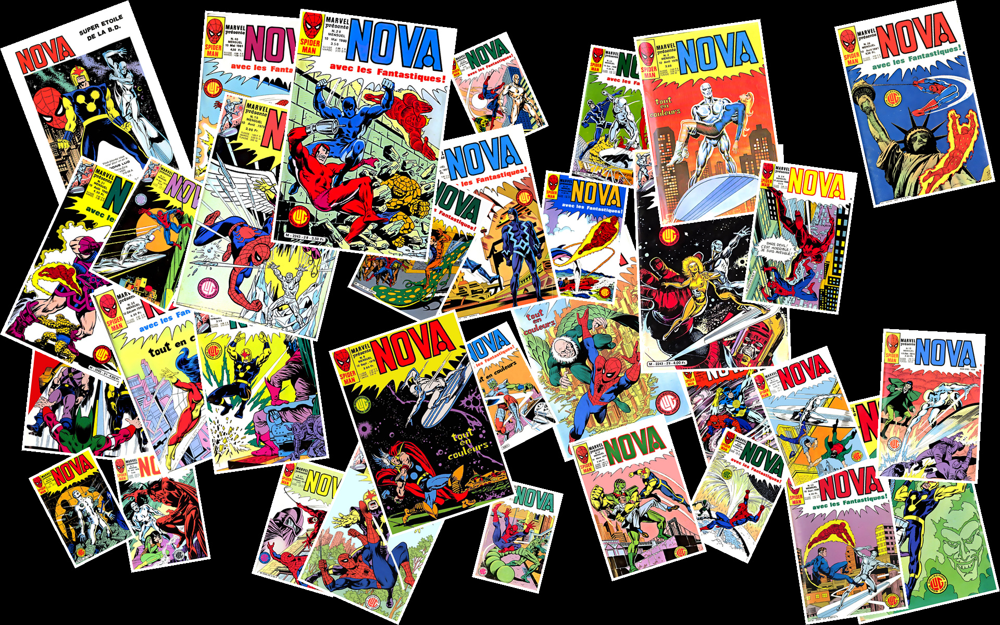

# Génération pele-mlel  artistique du patchwork
les photos seront disposées sur le fond noir avec des rotations différentes et aléatoires, comme un montage photographique ou un mur de photos.

Le script conservera :
- Une image finale de width × height pixels.
- Un fond noir.
- Jusqu'à max_photo photos JPG.
- Un cadre blanc fin autour de chaque photo.
- Des angles de rotation différents (horizontal, incliné à gauche ou à droite).
- Des tailles de photos variables pour un rendu plus naturel.
- Une disposition répartie sur toute la surface, sans alignement strict en grille.
- Les proportions originales des photos.

 
 


pip install Pillow

# Usage
patchwork.py [-h] [--path PATH]
                    [--max_photo MAX_PHOTO]
                    [--width WIDTH]
                    [--height HEIGHT]
                    [--output OUTPUT]

```bash
# Aide / Usage
python patchwork.py --help


# Génération d'un patchwork photo
python patchwork.py --path ./photos --max_photo 20 --width 3840 --height 1200 --output patchwork_holiday.jpg
```


options:
*  **-h, --help**
      show this help message and exit

*  **--path** PATH
      Répertoire contenant les photos (default: .)

*  **--max_photo** MAX_PHOTO
      Nombre maximum de photos (default: 15)

*  **--width** WIDTH
      Largeur du canvas (default: 1920)

*  **--height** HEIGHT
      Hauteur du canvas (default: 1200)

*  **--output** OUTPUT
      Nom du fichier de sortie (default: patchwork.jpg)
```
